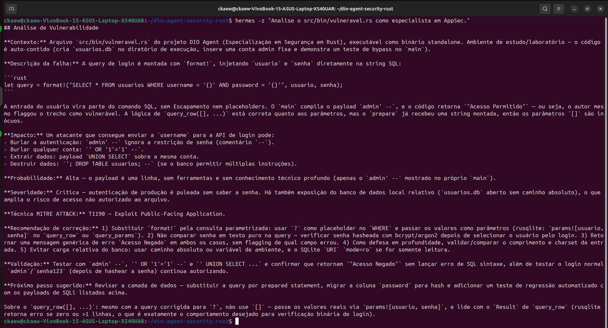
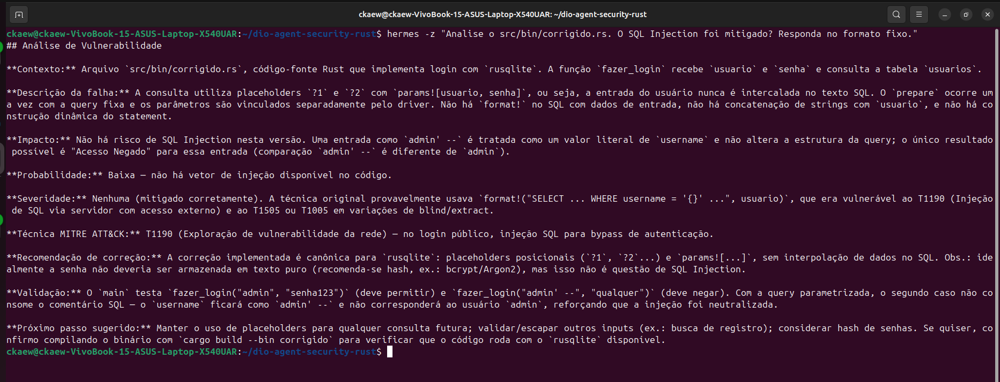
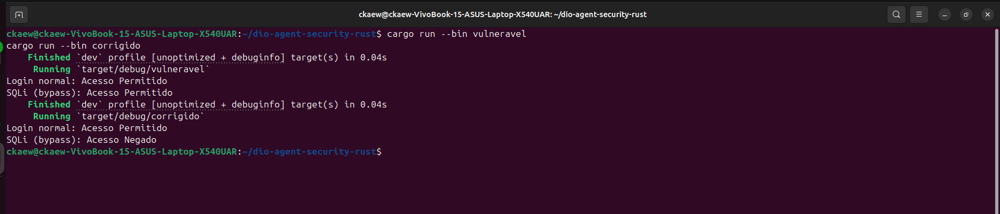

# DIO Agent — Especialização em Cibersegurança (Rust)

Versão em **Rust** da especialização em segurança do [DIO Agent](https://github.com/digitalinnovationone/dio-agent), usando o crate [rusqlite](https://crates.io/crates/rusqlite).

## Por que Rust

A skill vulnerability-analysis é **agnóstica de linguagem**: o conceito de SQL Injection e a correção com consulta parametrizada são os mesmos em Python e Rust. Este repositório prova isso com dois binários:

- cargo run --bin vulneravel → demonstra o SQL Injection (concatenação com format!).
- cargo run --bin corrigido → demonstra a correção (?1, ?2 + params![...]).

## Resultado dos testes

    $ cargo run --bin vulneravel
    Login normal: Acesso Permitido
    SQLi (bypass): Acesso Permitido    (vulnerável)

    $ cargo run --bin corrigido
    Login normal: Acesso Permitido
    SQLi (bypass): Acesso Negado       (seguro)

A diferença entre as duas saídas é a evidência de que a parametrização bloqueia o SQL Injection.

## O que tem aqui

- src/bin/vulneravel.rs: login com concatenação de string (vulnerável).
- src/bin/corrigido.rs: login com consulta parametrizada (seguro).
- agent/knowledge/security-basics.md: fundamentos de segurança (CID, MITRE, SQLi).
- skills/vulnerability-analysis/: skill de análise de vulnerabilidade.
- skills/security-testing/: skill de testes de segurança.
- AGENTS.md: fonte de verdade do agente.

## Como testar

    cargo run --bin vulneravel
    cargo run --bin corrigido

## Comparação Python x Rust

| Conceito | Python (sqlite3) | Rust (rusqlite) |
|----------|------------------|-----------------|
| Conexão | sqlite3.connect('db') | Connection::open("db")? |
| Query vulnerável | f"SELECT ... '{usuario}'" | format!("SELECT ... '{}'", usuario) |
| Placeholder | ? | ?1, ?2 |
| Parâmetros | (usuario, senha) | params![usuario, senha] |
| Execução | cursor.execute(query, params) | stmt.query_row(params, ...) |
| Erro | try/except | Result<T> com ? |

## Limitação conhecida

O harness Hermes não força o modelo a abrir o SKILL.md; o formato fixo literal é usado quando invocado explicitamente. Detalhes no AGENTS.md.

## Licença

MIT.

## Versão em Python

Este projeto tem uma versão em Python: [dio-agent-security](https://github.com/wil-ckaew/dio-agent-security).

## Prints da análise conduzida pelo Hermes (Rust)

### 1. Análise do `vulneravel.rs`

O agente identifica SQL Injection no `format!`, cita T1190 do MITRE ATT&CK, avalia impacto, probabilidade e severidade, e recomenda a correção com `?1`, `?2` e `params![]`.

### 2. Confirmação da mitigação no `corrigido.rs`

O agente confirma que o SQL Injection foi mitigado no `corrigido.rs`, no formato fixo.

### 3. Resultado do `cargo run`

Evidência de que o binário vulnerável permite o bypass e o corrigido bloqueia.

